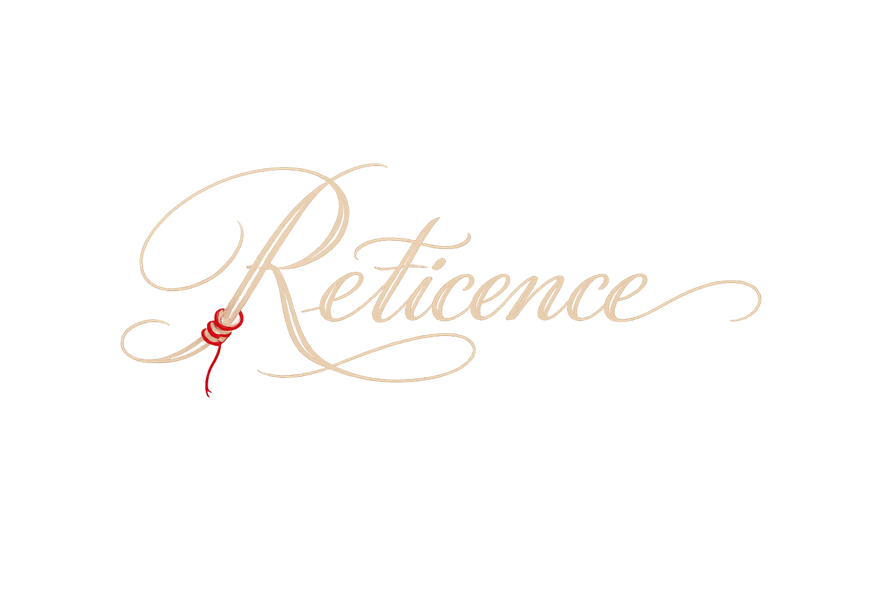

<div align="center">

# 🔍 Reticence

**关系线索墙 —— 用红线和图钉编织你的人际网络**

*A relationship clue wall app with red thread physics simulation*


---



</div>

## 📖 简介 | Introduction

**Reticence**（沉默）是一款侦探风格的关系线索墙应用。想象一位侦探在昏暗的办公室里，将线索卡片钉在软木板上，用红线串联关联线索——这就是 Reticence 的核心体验。

**Reticence** is a detective-style relationship clue wall app. Imagine a detective in a dim office, pinning clue cards to a cork board and connecting related clues with red threads — that's the core experience of Reticence.

## ✨ 功能特性 | Features

### 🎯 核心功能 | Core Features

| 功能 | 描述 |
|------|------|
| 🗂️ **线索卡片** | 创建卡片，支持自定义标签和描述 |
| 🧩 **线索类型** | 人物、地点、事件三种类型，专属图钉颜色与卡片徽章 |
| 📸 **照片卡片** | 拍立得/复古两种风格的照片卡片，支持从相册导入 |
| 🧵 **红线连接** | 用红线连接关联的卡片，支持自定义关系标签（如"同事"、"嫌疑人"） |
| 🎯 **关系类型** | 中立/盟友/敌对/自定义四种关系，线色随类型变化（红/绿/黑/蓝） |
| 🎚️ **关系筛选** | 顶部图例实时显示四类关系数量，点选即可聚焦某类关系 |
| 🔎 **网络聚焦** | 点选卡片/照片只保留其一度关系网络，其余卡片与连线淡化 |
| 🌊 **拨动红线** | 长按红线注入局部波动，波纹沿绳子传播并带动相邻连线 |
| 🔍 **全局搜索** | 搜索卡片名称、标签、描述、类型、连线标签和关系类型 |
| ↩️ **撤销/重做** | 完整的操作历史，支持 Ctrl+Z / Ctrl+Y 快捷键 |
| 💾 **本地存储** | 使用 SQLite 数据库持久化所有数据，离线可用 |
| 📤 **导出分享** | 将线索墙截图导出为 PNG，支持系统分享菜单 |

### 🎨 视觉体验 | Visual Experience

- **软木板美学**：精心设计的暖棕色色调，模拟真实软木板质感
- **红线物理模拟**：红线具有下垂效果和轻微摆动动画，如同真实棉线
- **可拨动的波纹**：长按红线在触点产生局部波动，沿绳子传播、阻尼衰减，并通过共享卡片带动相邻连线
- **关系线配色**：中立红、盟友绿、敌对黑、自定义蓝，一眼看懂关系网络
- **关系图例**：顶部实时显示四类关系的颜色与数量，点选即可筛选
- **网络聚焦**：点选一张卡片/照片，立即看清它的一度关系网络，其余内容淡化退后
- **图钉装饰**：红、蓝、黄铜三种图钉颜色对应人物、地点、事件类型
- **卡片浮动效果**：选中的卡片会轻微浮动，营造层次感
- **纸张纹理**：卡片表面的旧纸纹理和噪点效果，增加年代感
- **暗色模式**：完整的暗色主题支持，保持侦探办公室氛围

### 🕹️ 交互设计 | Interaction Design

- **双指缩放**：在 0.3x - 3.0x 范围内自由缩放画布
- **拖拽移动**：直接拖拽卡片到任意位置
- **图钉连线**：长按图钉拖拽到目标卡片即可建立连接
- **双击编辑**：双击卡片查看详情并编辑
- **点击红线**：点击连线查看和编辑关系标签
- **网络聚焦**：点击卡片/照片进入一度关系聚焦；点击焦点徽章、空白处或再点选中项退出
- **拨动红线**：长按连线，波纹从触点沿绳子传播并逐渐衰减
- **关系筛选**：点击顶部图例只看某类关系，再次点击或点"全部"恢复；未选类型淡化显示
- **键盘快捷键**：
  - `Ctrl+Z` 撤销
  - `Ctrl+Y` / `Ctrl+Shift+Z` 重做
  - `Delete` 删除选中
  - `Escape` 取消选择

## 📱 截图 | Screenshots

<div align="center">
<p><i>Coming soon...</i></p>
</div>

## 🛠️ 技术栈 | Tech Stack

| 类别 | 技术 |
|------|------|
| **框架** | [Flutter](https://flutter.dev/) 3.6+ |
| **语言** | [Dart](https://dart.dev/) 3.6+ |
| **状态管理** | [Riverpod](https://riverpod.dev/) 2.6+ |
| **数据库** | [Drift](https://drift.simonbinder.eu/) (SQLite) 2.22+ |
| **架构模式** | Repository + Provider + Command Pattern |
| **自定义绘制** | CustomPainter（弦波、纸张纹理、图钉） |

## 📁 项目结构 | Project Structure

```
lib/
├── main.dart                    # 应用入口
├── models/                      # 数据模型
│   ├── card_model.dart         # 线索卡片模型
│   ├── connection_model.dart   # 连接关系模型
│   ├── photo_card_model.dart   # 照片卡片模型
│   ├── thread_pluck_event.dart # 长按拨动事件
│   └── rendered_connection.dart # 渲染用连接数据
├── providers/                   # Riverpod 状态管理
│   ├── card_provider.dart      # 卡片状态
│   ├── connection_provider.dart # 连接状态
│   ├── photo_provider.dart     # 照片状态
│   ├── relationship_filter_provider.dart # 关系类型筛选
│   ├── undo_redo_provider.dart # 撤销/重做
│   ├── commands/               # 命令模式实现
│   └── handlers/               # 交互处理器
├── screens/                     # 页面
│   ├── clue_wall_screen.dart   # 线索墙主屏幕
│   ├── focus_mode_badge.dart   # 网络聚焦徽章
│   ├── relationship_legend_bar.dart # 关系图例与筛选
│   ├── thread_layer.dart       # 红线渲染与波动驱动
│   └── top_bar.dart            # 顶部栏（含图例入口）
├── services/                    # 服务层
│   ├── database/               # Drift 数据库
│   └── repositories/           # 数据仓库
├── theme/                       # 主题配置
│   ├── app_colors.dart         # 色彩体系
│   ├── app_typography.dart     # 字体排版
│   ├── clue_type_style.dart    # 线索/关系类型图标与配色
│   └── wall_constants.dart     # 画布常量
├── utils/                       # 工具类
│   ├── canvas_matrix.dart      # 画布矩阵计算
│   ├── export_utils.dart       # 导出工具
│   ├── thread_wave.dart        # 红线弦波模拟
│   └── gesture_coordinator.dart # 手势协调
└── widgets/                     # 组件
    ├── clue_card_widget.dart   # 线索卡片
    ├── photo_card_widget.dart  # 照片卡片
    ├── dialogs/                # 对话框
    │   ├── type_selectors.dart # 线索/关系类型选择器
    │   └── ...
    └── painters/               # 自定义绘制器
        ├── red_thread_painter.dart    # 红线绘制
        ├── pushpin_decorator.dart     # 图钉装饰
        └── paper_texture_background.dart # 纸张纹理
```

## 🚀 快速开始 | Getting Started

### 环境要求 | Prerequisites

- Flutter SDK >= 3.6.0
- Dart SDK >= 3.6.0
- Android Studio / VS Code
- Android SDK 或 Xcode (iOS)

### 安装步骤 | Installation

```bash
# 克隆仓库 | Clone the repository
git clone https://github.com/your-username/reticence.git

# 进入项目目录 | Navigate to project directory
cd reticence

# 安装依赖 | Install dependencies
flutter pub get

# 运行代码生成 | Run code generation
dart run build_runner build

# 运行应用 | Run the app
flutter run
```

### 代码生成 | Code Generation

本项目使用代码生成来减少模板代码：

```bash
# 监听文件变化并自动生成 | Watch and auto-generate
dart run build_runner watch

# 一次性生成 | One-time generation
dart run build_runner build --delete-conflicting-outputs
```

## 🏗️ 架构设计 | Architecture

### 状态管理 | State Management

采用 **Riverpod** 进行状态管理，结合 **Command Pattern** 实现撤销/重做：

```
┌─────────────────────────────────────────────────────────────┐
│                      UI Layer (Widgets)                      │
├─────────────────────────────────────────────────────────────┤
│                   Provider Layer (Riverpod)                  │
│  ┌─────────────┐ ┌─────────────┐ ┌─────────────┐           │
│  │ CardProvider │ │ConnectionProvider│ │ PhotoProvider│         │
│  └──────┬──────┘ └──────┬──────┘ └──────┬──────┘           │
│         │               │               │                   │
│  ┌──────▼───────────────▼───────────────▼──────┐           │
│  │              UndoRedoProvider                │           │
│  │         (Command Pattern Stack)              │           │
│  └─────────────────────────────────────────────┘           │
├─────────────────────────────────────────────────────────────┤
│                   Repository Layer                           │
│  ┌─────────────┐ ┌─────────────┐ ┌─────────────┐           │
│  │ CardRepository│ │ConnectionRepository│ │PhotoRepository│     │
│  └──────┬──────┘ └──────┬──────┘ └──────┬──────┘           │
│         └───────────────┼───────────────┘                   │
│                         ▼                                   │
│              ┌─────────────────────┐                        │
│              │   Drift Database    │                        │
│              │   (SQLite Local)    │                        │
│              └─────────────────────┘                        │
└─────────────────────────────────────────────────────────────┘
```

### 渲染层次 | Rendering Layers

画布内容按以下层次从下到上渲染，模拟真实线索墙效果：

```
7. 搜索结果徽章 / 空状态提示
6. 正在拖拽的照片
5. 浮动/选中卡片 (在红线之上)
4. 正在连线的动态线
3. 红线连接层 (IgnorePointer)
2. 独立照片卡片
1. 普通卡片 (被红线覆盖)
```

## 🎨 设计语言 | Design Language

### 色彩体系 | Color System

| 用途 | 颜色 | 说明 |
|------|------|------|
| 软木板 | `#4A3C30` | 模拟真实软木板的棕褐色调 |
| 旧纸张 | `#EDE5D5` | 泛黄的旧纸色，非纯白 |
| 墨水 | `#1A1308` | 老式钢笔墨水的深棕黑色 |
| 红线 | `#7A2A20` | 偏暗红的棉线颜色 |
| 黄铜图钉 | `#B09840` | 金属质感的图钉 |

### 类型视觉 | Type Visuals

| 线索类型 | 图钉颜色 | 卡片徽章 |
|---------|---------|---------|
| 人物 | 红 `#8A3030` | 👤 人物 |
| 地点 | 蓝 `#405870` | 📍 地点 |
| 事件 | 黄铜 `#B09840` | 🗓 事件 |

| 关系类型 | 红线颜色 | 含义 |
|---------|---------|------|
| 中立 | `#7A2A20` | 默认关系，经典红线 |
| 盟友 | `#4A6840` | 信任、合作 |
| 敌对 | `#241C16` | 冲突、对立 |
| 自定义 | `#587080` | 用户自定义关系 |

### 字体 | Typography

- **Caveat**：手写风格，用于标题和装饰文字
- **Source Serif 4**：衬线字体，用于英文正文
- **LXGW WenKai**：霞鹜文楷，用于中文正文
- **HarmonyOS Sans SC**：鸿蒙字体，用于 UI 元素
- **Noto Serif CJK SC**：思源宋体，用于强调文字

## 📄 许可证 | License

本项目采用 MIT 许可证 - 详见 [LICENSE](LICENSE) 文件

This project is licensed under the MIT License - see the [LICENSE](LICENSE) file for details.

## 🙏 致谢 | Acknowledgments

- [Flutter](https://flutter.dev/) - 构建精美应用的 UI 工具包
- [Riverpod](https://riverpod.dev/) - 现代化的状态管理方案
- [Drift](https://drift.simonbinder.eu/) - 类型安全的 SQLite 封装
- 所有为这个项目提供灵感的侦探小说和电影

---

<div align="center">

**用红线编织真相，用图钉固定线索**

*Weave truth with red threads, fix clues with pushpins*

</div>
